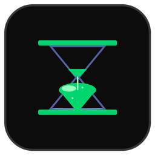
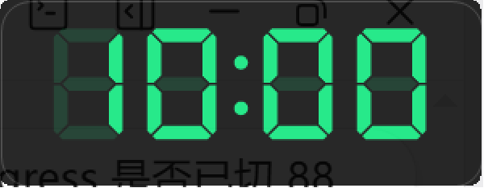

# PPT沙漏 pptglass

<p align="center">
  
</p>

一个极简的 PPT / WPS 放映计时器：屏幕右上角一条纯黑时间条，双击即开始计时并启动放映，放映结束自动复位。

<p align="center">
  
</p>

## 功能

- **自动计时**：检测到 PowerPoint / WPS 进入放映，自动开始倒计时；退出放映自动停止复位
- **双击联动**：双击时间条 = 开始计时 + 启动当前打开的演示文稿放映（PowerPoint / WPS 均支持，COM 联动）
- **预铃提醒**：剩余 N 分钟时数字变橙、弹出提示并播放声音（0–30 分钟可配）
- **超时提示**：到点后红色闪烁 + 超时正计时 + 自定义提示语 + 声音
- **手动控制**：F12 开始 / Ctrl+F12 停止 / Win+ESC 退出（可在 ini 修改），也可双击或右键菜单操作
- **悬停交互**：时间条默认鼠标穿透，不遮挡放映；鼠标悬停时浮出 ⚙ 设置 / ℹ 关于 / ✕ 退出
- **设置**：限时 1–99 分钟、预铃、音量、声音文件、超时提示语、自动隐藏、开机自启（均持久化到 ini）
- **半透明**：时间条 84% 不透明度（ini 可调），尽量少遮挡演示内容

## 使用

**方式一（推荐）**：从 [Releases](https://github.com/jdstkxx/PPTGlass/releases) 下载 `pptglass.exe`（字体与提示音已内嵌，首次运行自动解包到临时目录），运行后打开你的 PPT / WPS 演示文稿，双击右上角时间条即可。

**方式二（源码运行）**：

```
git clone https://github.com/jdstkxx/PPTGlass.git
cd PPTGlass
copy fonts\DSEG7.ttf src\          # 脚本运行/编译时从同目录取资源
copy soundslarm1.wav srccopy soundslarm2.wav src```

然后用 AutoHotkey 1.1 直接运行 `src\pptglass.ahk`。

**编译单文件 exe**：安装 [AutoHotkey 1.1](https://www.autohotkey.com/) 与 [Ahk2Exe](https://github.com/AutoHotkey/Ahk2Exe)（随 AHK 附带），执行：

```
Ahk2Exe.exe /in src\pptglass.ahk /out pptglass.exe /base AutoHotkeyU64.exe /icon ppttimer_icon.ico
```

（图标文件见 [Release 附件](https://github.com/jdstkxx/PPTGlass/releases/tag/v1.0.0)。）

## 实现原理

程序本体是 [AutoHotkey 1.1](https://www.autohotkey.com/) 脚本，全部界面与逻辑在 `src/pptglass.ahk`（约 700 行，含注释）：

1. **放映检测**（`PollShow`/`IsSlideShow`）：250ms 轮询——PowerPoint 放映窗口类 `screenClass`，以及 WPS 演示进程（wpp.exe/wps.exe）中"可见 + 置顶 + 全屏"的窗口（双策略，兼容新版 WPS 类名变化）
2. **倒计时渲染**（`DrawCard`/`DrawLed`）：GDI+ 绘制纯黑圆角位图 → `STM_SETIMAGE` 送入 Pic 控件呈现；数字使用 [DSEG7](https://github.com/keshikan/DSEG) 七段数码管字体（GDI+ 私有字体集合加载，免安装；缺失时自动回退内置段绘制引擎）
3. **放映联动**（`StartSlideshow`）：COM（`ComObjActive`）挂接已运行的 PowerPoint / WPS 实例，`SlideShowSettings.Run()` 启动放映
4. **交互**：时间条默认 `WS_EX_TRANSPARENT` 鼠标穿透；悬停时移除穿透浮出按钮（⚙ ℹ ✕）；拖动靠 `WM_NCLBUTTONDOWN` 原生移动；单文件版用 `FileInstall` 内嵌资源，运行时解包到 `%TEMP%`

## 源码结构

```
src/pptglass.ahk    全部源码：界面绘制、放映检测、倒计时、COM 联动、设置窗
fonts/DSEG7.ttf     LED 字体（运行时依赖，SIL OFL 1.1，见 fonts/DSEG-README.md）
sounds/             提示音（预铃 alarm1 / 结束 alarm2，WAV 44.1kHz）
```

界面是纯代码绘制的（GDI+ 位图 + 消息处理），没有窗体资源文件——**其他用户 clone 后按上面步骤补齐字体/声音即可直接修改运行**：改配色搜 `StateColor`，改尺寸搜 `CW :=`，改检测逻辑搜 `IsSlideShow`。

## 开发工具

| 工具 | 用途 |
|---|---|
| [AutoHotkey 1.1.37](https://www.autohotkey.com/) | 脚本运行时 |
| [Ahk2Exe](https://github.com/AutoHotkey/Ahk2Exe) | 编译为单文件 exe（FileInstall 内嵌资源） |
| [DSEG7 Classic](https://github.com/keshikan/DSEG) | 七段数码管字体（SIL OFL 1.1） |
| GDI+ / Win32 API | 卡片绘制、放映窗口检测、COM 联动 |

## 作者

**jdstkxx** · [github.com/jdstkxx](https://github.com/jdstkxx)

灵感与功能清单参考陈家琪老师的《PPT播放提示钟》（2003）。

## 许可证

[MIT License](LICENSE) · 字体 DSEG7 适用 [SIL OFL 1.1](fonts/DSEG-README.md)
